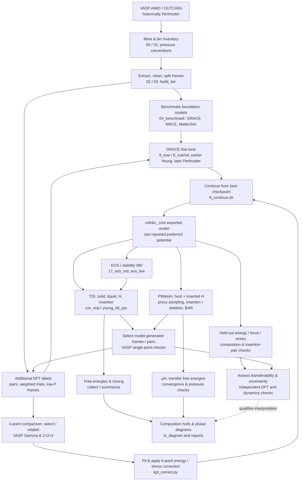
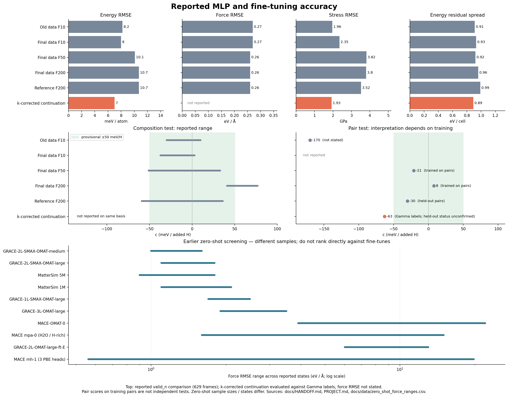

# Workflows and recorded model results

This map describes the checkout on `gpt/youthful-jolly-review` (reviewed 2026-11-10). It combines the current `docs/HANDOFF.md` and `docs/RECIPES.md` with the older project, pipeline, validation, PWidom and cluster notes. Many notes describe a historical branch or an unfinished plan; dates and statuses below are the last **reported**, not verified live cluster state. Code and small reference data are in Git; `runs/`, model exports, raw DFT and most results are not in this checkout.



## Reading the paths

- **Data and training:** `PROJECT.md`, `mlp_pipeline/README.md`, `docs/RECIPES.md`, `docs/HANDOFF.md` sections 2–4. DFT labels use electronic free energies; pressure and stress conventions matter. The latest handoff describes `mfin` (4,290 training and 836 validation frames) and a correction fit to 300 k-point comparisons. The correction is fitted, not a full k-mesh relabelling of every frame.
- **Model checking:** `docs/MODEL_TEST_SUITE.md` describes proposed tests; `docs/GRACE_RELIABILITY_PLAN.md`, `docs/PWIDOM_DFT_VALIDATION.md`, and `docs/status/GRACE_DFT_AUDIT_2026-11-01.md` document earlier checks. Their ft_m2 conclusions do not automatically measure the final potential. Composition and insertion-pair errors matter alongside aggregate RMSE. Some pair scores use pairs seen in training.
- **EOS and free energies:** `docs/RECIPES.md`, `docs/TDI_PLAN.md`, `docs/TDI_OUTPUT.md`, `docs/MU_METHODS.md` and `docs/CODEBASE.md`. TDI and PWidom are distinct routes; free-energy outputs need sampling, phase, pressure, finite-size and model-bias checks. Existing phase diagrams based on old ft_m2 are not results for mfinkc_cont.
- **PWidom, restart and DFT:** `RUNNING.md`, `docs/PWIDOM_RESULTS.md`, `docs/PWIDOM_RESUME.md`, `docs/PWIDOM_TIME_HULLS.md`, `docs/PWIDOM_VASP.md`, and `docs/PWIDOM_PURE_VASP.md`. The restart/checkpoint data and raw work arrays are needed for some convergence analyses, not just the final model.
- **Cluster execution:** `docs/RECIPES.md` and `run.sh` describe Perlmutter defaults; historical `young_*.sh` and `.sbatch` scripts target Young. Check accounts, paths, Python environments, modules and scheduler settings before moving a calculation. Several legacy launchers default to `ft_m2`; explicitly set the desired model. The code's model factory searches recursively for a SavedModel if given a run directory, so confirm the printed model path or specify the export directly.

## Combined accuracy figure



[PDF version](figures/reported_model_accuracy.pdf). Recreate with `python scripts/plot_reported_model_accuracy.py`; the plotted fine-tune values are transcribed in `docs/data/model_accuracy_reported.csv` from `docs/HANDOFF.md` section 2 and the later scored update in section 3. The zero-shot ranges are from `docs/data/zero_shot_force_ranges.csv`, with sample caveats in `PROJECT.md`. F10/F50/F200 refer to force loss weights; reference F200 excludes the pair set in training. The composition bars show documented ranges, not uncertainty intervals. The ±50 meV/H band is a provisional project criterion. For F200 the documented +41 to +77 range is specifically the +9 H cases.

The 629-frame `valid_n` scores and later Gamma-label score are reported in the handoff; raw scores are not in this checkout, so the exact evaluation setup for the latter cannot be independently confirmed. The k-corrected continuation also reports **9.7 meV/atom energy RMSE, 0.201 eV/Å force MAE and 2.2 GPa stress RMSE on k-corrected labels**. These are separate from the plotted Gamma-label scores and the force MAE is not a force RMSE. Its pair result (-63 meV/H) is against Gamma labels, and the notes do not establish independent holdout status. The predicted k-level composition range (-45 to +12 meV/H) is correction-adjusted and is not plotted as if it were the same Gamma-label test.

## Moving a useful subset to Young

The latest reported model is `runs/grace/ft_mfinkc_cont`, with its exported SavedModel normally under `seed/1/final_model`. The actual files, size, and newest state have not been checked on Perlmutter. Copy the entire run directory first if small enough: it preserves the export, model configuration, logs and checkpoints. If only the exported model is copied, keep its `saved_model.pb` **and the complete containing directory including variables and assets**. Retain the Perlmutter original and validate an identical prediction on Young before relying on it. For further fine-tuning, checkpoints and `seed/1/model.yaml` are also needed; an inference export alone is not the complete training state.

Useful small companions include `runs/grace/ft_mfin_f_lr1e-2_e50` (parent model for comparison/continuation), training and validation frame files, score outputs/logs, `runs/kpt222mp/kcorr.json` and its provenance, and the inventory/EOS data used by the chosen workflows. Determine their actual sizes and availability first; raw DFT and old trajectories can remain on Perlmutter until a particular analysis needs them. Some old manifests contain absolute Perlmutter paths, so copying folders alone does not guarantee restart or analysis works. Never reuse old simulation checkpoints with a different potential as if they were the same Hamiltonian.

On the Perlmutter login node, from the repository root, inspect without changing files:

```bash
du -sh runs/grace/ft_mfinkc_cont runs/grace/ft_mfin_f_lr1e-2_e50 runs/kpt222mp/kcorr.json runs/train_mfin.extxyz runs/valid_mfin.extxyz 2>/dev/null; find runs/grace/ft_mfinkc_cont -name saved_model.pb -print
```

Confirm the actual exported path, Young destination, connectivity and installed GRACE/TensorFlow environment before choosing a transfer command. No files have been moved or deleted in this review.
